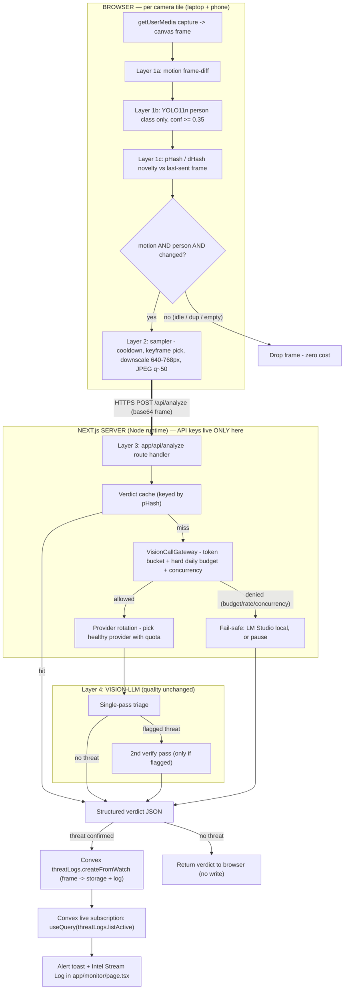
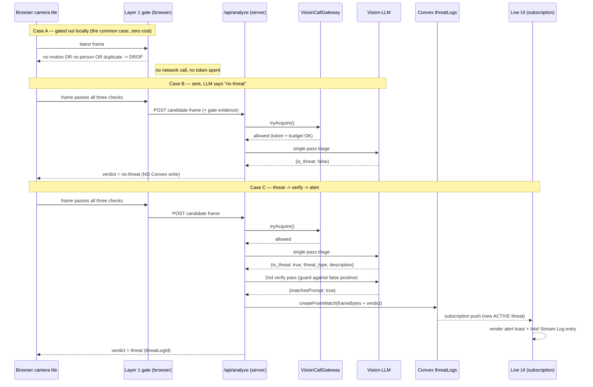
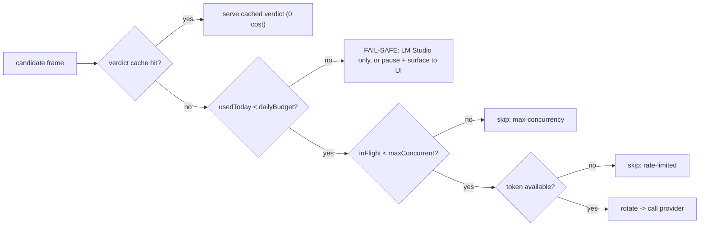
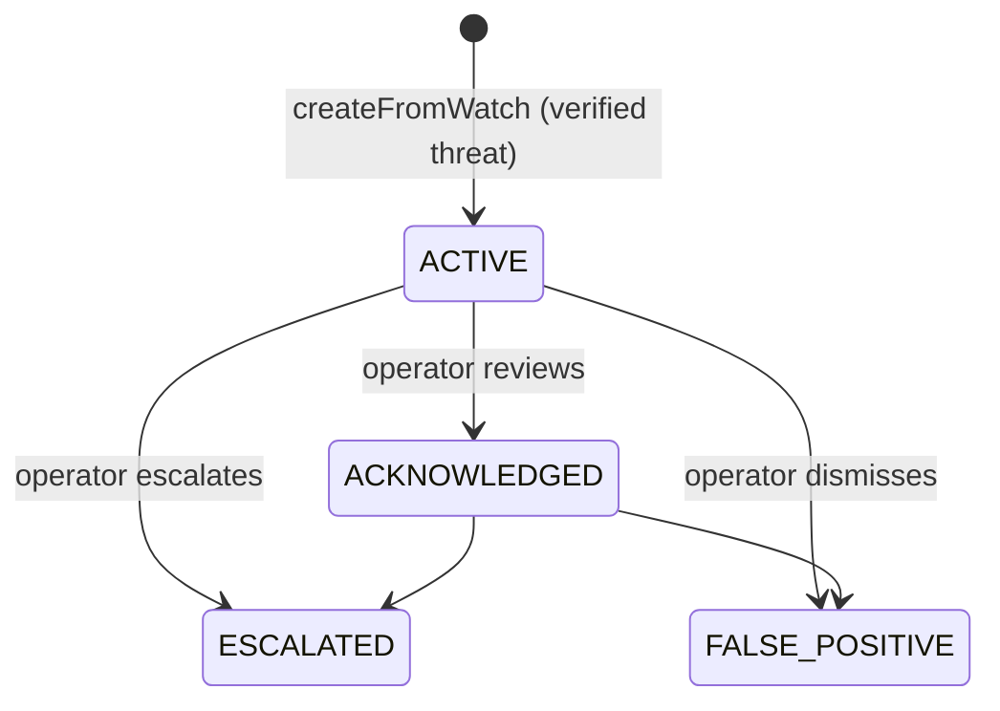

# 02 — System Architecture

> How CAMX2 turns two live browser cameras into budget-safe, LLM-verified threat alerts without burning free-tier API quota.

This document describes the **live monitoring grid** only. For the "why" and product requirements see [01-PRD.md](01-PRD.md); for the quota arithmetic see [03-FREE-TIER-BUDGET.md](03-FREE-TIER-BUDGET.md); for the build order see [04-IMPLEMENTATION-PHASES.md](04-IMPLEMENTATION-PHASES.md); for prompts and the detection contract see [05-DETECTION-AND-PROMPTS.md](05-DETECTION-AND-PROMPTS.md).

---

## Context: two distinct systems in this repo

The repository contains **two independent vision pipelines**. They share providers, prompts, and the `threatLogs`/Convex layer, but they are architecturally separate. This doc covers only the first.

| | **Live Monitoring Grid** (THIS doc) | **Upload / Q&A Timeline** (out of scope) |
|---|---|---|
| Input | Laptop webcam + phone camera via browser `getUserMedia` / IP-webcam | Pre-recorded video file upload |
| Trigger | Continuous, real-time, per-frame | One-shot, on upload |
| Frame source | Browser canvas capture | `ffmpeg` frame extraction in the worker |
| Latency budget | Sub-second, sustained for 1+ hour | Batch, seconds-to-minutes |
| Core risk | **Cost/rate** — naive frame-sending burns quota in minutes | Throughput + caching |
| Entry points | `app/monitor/page.tsx`, `components/camera/CameraCard.tsx` | `app/analysis/**`, `app/api/video-analysis/**` |
| Worker code | `apps/worker/watch/**` (watch loop) | `apps/worker/video/**` + `runtime.ts` capture |
| Convex sink | `threatLogs` | `videoJobs`, `timelineEntries` (vector search) |

> **Reality check:** today the browser live path (`hooks/useLiveDetection.ts`, `CameraCard.tsx`) runs **only** in-browser YOLO11n and never calls an LLM. The LLM watch pipeline (`apps/worker/watch/runtime.ts`) already implements the four-layer pattern — but it captures frames with `ffmpeg` from **network/IP cameras** and generates a *mock* frame for `device` cameras, so a laptop/phone webcam never reaches the LLM. This architecture closes that gap: it moves the cheap gate into the browser and adds a server proxy so device cameras get the same budget-safe LLM detection the worker already proves out.

---

## High-level architecture

Four layers. Each layer's job is to let **fewer, better frames** reach the next one. The LLM (Layer 4) is the detector and its quality is intentionally untouched — every other layer exists purely to protect its free-tier budget.



---

## Component responsibilities

Each component has one job. "Where" is the runtime it executes in.

| Component | Where | Single responsibility |
|---|---|---|
| `getUserMedia` capture + canvas sample | Browser | Grab the latest frame from a live camera tile into an `ImageData`/JPEG. |
| **Layer 1a — motion** frame-diff | Browser | Cheap mean-abs-diff of a tiny grayscale thumbnail vs the previous frame; suppress static footage. Mirrors `apps/worker/watch/motion.ts`. |
| **Layer 1b — person gate** (YOLO11n) | Browser | Run the *existing* in-browser ONNX session, but keep **only** COCO class `person` (id 0) at conf ≥ ~0.35. It must **not** try to detect weapons. |
| **Layer 1c — novelty** (pHash/dHash) | Browser | Perceptual-hash dedup vs the last **sent** frame; drop near-duplicates. |
| **Layer 2 — sampler** | Browser | Per-camera cooldown/debounce, pick the most-changed keyframe in a ~2–3s window, downscale to 640–768px @ JPEG q~50, and POST. |
| **Layer 3 — proxy** (`/api/analyze`) | Next.js server | Hold API keys, run the budget/rate gate, rotate providers, call the LLM, run the verify pass, write to Convex. The **only** place keys exist. |
| **VisionCallGateway** | Next.js server | Token bucket + hard daily budget + concurrency cap. Reused pattern from `apps/worker/watch/rateLimiter.ts`. |
| **Provider chain** | Next.js server | `createWatchProvider()` factory → `FallbackWatchProvider` over Gemini/Groq/LM Studio (+NVIDIA). From `apps/worker/watch/providers/**`. |
| **Layer 4 — vision-LLM** | Provider (cloud) or LM Studio (local) | The detector. Returns structured JSON. Quality unchanged from direct frame-sending. |
| `threatLogs` (Convex) | Convex | Durable, real-time store of verified threats + frame image. `convex/threatLogs.ts`. |
| Live UI subscription | Browser | `useQuery(api.threatLogs.listActive)` streams new threats into alerts + the Intel Stream Log (`app/monitor/page.tsx`). |

---

## Frame lifecycle

Three cases, in order of frequency. The overwhelming majority of frames end at Case A and cost **nothing**.



If the verify pass returns `matchesPrompt: false`, the threat is **overturned**: no Convex write, no alert — exactly the `overturned` path already in `runtime.ts`.

---

## Server proxy design

**Route (recommended default):** a Next.js **Route Handler** at `app/api/analyze/route.ts`, `POST` only. This mirrors the existing proxy pattern in `app/api/video-analysis/jobs/route.ts` (browser → Next route → downstream), and keeps the browser bundle free of any provider SDK or key.

```ts
// app/api/analyze/route.ts
export const runtime = "nodejs"; // NOT edge: needs process.env keys + provider fetch
export async function POST(request: Request) { /* gate -> rotate -> LLM -> verify -> Convex */ }
```

**How the key is held:** providers read keys from **server-only** env (`GEMINI_API_KEY`, `GROQ_API_KEY`, `NVIDIA_API_KEY`, `LMSTUDIO_BASE_URL`) at construction time (see `GeminiProvider` constructor throwing when `GEMINI_API_KEY` is unset). Because the route runs in the Node runtime, these never ship to the client. **No `NEXT_PUBLIC_` prefix** on any key. The browser only ever sends image bytes; it never sees a provider or a key.

**Request contract (browser → `/api/analyze`):**

```jsonc
{
  "cameraId": "cam-webcam-0",
  "requestId": "live-9f3a2b7",          // client idempotency key (dedups Convex writes)
  "timestamp": "2026-09-27T12:00:00.000Z",
  "frame": "<base64 JPEG>",             // downscaled 640-768px, q~50
  "mimeType": "image/jpeg",
  "phash": "f0e1d2c3...",               // Layer-1c hash: verdict-cache key + server-side novelty
  "gate": {                             // Layer-1 evidence, becomes LLM context + audit trail
    "personPresent": true,
    "motionScore": 0.12
  },
  "burst": ["<base64>", "<base64>"]     // optional: ordered keyframe burst for temporal context
}
```

**Response contract (`/api/analyze` → browser):**

```jsonc
{
  "ok": true,
  "verdict": {
    "is_threat": false,
    "threat_type": null,                // "weapon" | "fight" | "fire" | ... when is_threat
    "description": null,                // required non-empty when is_threat = true
    "confidence": 0.0,                  // 0..1
    "boxes": []                         // optional [{x1,y1,x2,y2,label}]
  },
  "verified": false,                    // true only after a passing 2nd verify call
  "provider": "gemini",                 // which provider answered
  "cached": false,                      // verdict-cache hit (no LLM call spent)?
  "budget": { "usedToday": 42, "dailyBudget": 500, "remaining": 458 },
  "threatLogId": null                   // set when a Convex threatLog was created
}
```

**Denied response (budget/rate guard tripped, before any LLM call):**

```jsonc
{ "ok": false, "skipped": "daily-budget-exhausted", // | "rate-limited" | "max-concurrency"
  "budget": { "usedToday": 500, "dailyBudget": 500, "remaining": 0 } }
```

> **Contract reconciliation.** The existing worker parser (`apps/worker/watch/schema.ts`) speaks `{ isHarm, description }`. The richer `{ is_threat, threat_type, description, confidence, boxes? }` above is a superset for the live path; a thin adapter maps `isHarm → is_threat` and defaults `confidence`. The Convex `confidence` field is a **0–100** number (`classifySeverity` treats ≥90 critical), so the proxy scales `verdict.confidence * 100` when calling `createFromWatch`. See [05-DETECTION-AND-PROMPTS.md](05-DETECTION-AND-PROMPTS.md) for the full schema and prompts.

---

## Budget / rate limiter design

The gate reduces *volume*; the gateway is the **hard ceiling** that a misfiring gate or an event burst can never breach. Reuse the existing `VisionCallGateway` from `apps/worker/watch/rateLimiter.ts` — extract it to a shared module (e.g. `lib/live/visionGateway.ts`) importable by both the worker loop and the new `/api/analyze` route.

It combines three guards, checked in `tryAcquire()` order:

1. **Hard daily budget** — `usedToday >= dailyBudget` → deny `daily-budget-exhausted`. Resets at local midnight (`rollDay()`). This is the fail-safe that **cannot** be exceeded.
2. **Concurrency cap** — `inFlight >= maxConcurrent` → deny `max-concurrency`. Caller must `release()` in a `finally`.
3. **Token bucket** — steady calls/min with a small burst allowance; empty → deny `rate-limited`.



**Recommended defaults** (live 2-camera demo; env-overridable — the worker ships with `WATCH_RATE_PER_MIN=12`, but the live grid tightens this):

| Env var | Recommended default | Meaning |
|---|---|---|
| `WATCH_RATE_PER_MIN` | **8** | ≈480 calls/hour — fits a single free tier for 1 hour. |
| `WATCH_RATE_BURST` | 4 | Short event bursts absorbed without stalling. |
| `WATCH_DAILY_BUDGET` | 500 | Hard daily ceiling (matches free-tier rpd order). |
| `WATCH_MAX_CONCURRENT` | 2 | One per camera; bounds tail latency. |

**Fallback to LM Studio:** on `daily-budget-exhausted` (or all cloud providers failing), the proxy degrades to **LM Studio local** (unlimited, offline) instead of erroring, and the response flags reduced capacity so the UI can show a "budget" indicator. See the arithmetic in [03-FREE-TIER-BUDGET.md](03-FREE-TIER-BUDGET.md).

---

## Provider abstraction

Providers plug in behind one interface — `WatchProvider` (`apps/worker/watch/providers/types.ts`) with `analyzeFrame`, `analyzeBurst`, and `verifyHarm`. Each concrete provider (`GeminiProvider`, `GroqProvider`, `LmStudioProvider`) reads its key/URL in its constructor and **throws if unconfigured**.

`createWatchProvider()` (`providers/factory.ts`) builds the active provider:

- Reads `WATCH_PROVIDER` (default `gemini`), then orders the chain as `[selected, ...rest]`, always ending in LM Studio.
- `tryBuild()` skips any provider whose key is missing (logs, returns `null`).
- Wraps survivors in a `FallbackWatchProvider`. LM Studio never throws at construction, so the chain is never empty.

**Current behavior = error-only fallback.** `FallbackWatchProvider` tries providers in fixed order and only advances **on a thrown error** (network / 429 / unparseable). A valid answer — even "no harm" — is success and stops the chain. So today Gemini takes *every* call and Groq is touched only when Gemini errors.

**Rotation (the change for the live path).** For budget spreading we want to **rotate the starting provider per call** rather than always leading with Gemini:

| | Error-only fallback (current) | Rotation (target) |
|---|---|---|
| Provider choice | Always start at chain head (Gemini) | Pick next **healthy provider with remaining quota** (round-robin / least-recently-used) |
| Advances when | A provider **throws** | Same — error still falls through to the next |
| Effect on quota | One provider absorbs all load, hits rpm/rpd first | Load spread across providers → combined headroom |

Implementation: keep `FallbackWatchProvider` as the inner **error-resilience** layer, but have the gateway (or a small rotator around the factory) choose the **starting** provider per call from those with budget left. Error fallback then continues from that start point. Also **wire NVIDIA NIM** (a new `providers/NvidiaProvider.ts`) into the chain — it is referenced but not implemented today. Full provider quotas and rotation ordering live in [03-FREE-TIER-BUDGET.md](03-FREE-TIER-BUDGET.md).

---

## Data model touchpoints

The live path writes to one Convex collection: **`threatLogs`** (`convex/schema.ts`, `convex/threatLogs.ts`). The proxy calls the `createFromWatch` **action**, which (1) stores the frame JPEG in Convex storage, (2) resolves its URL, and (3) inserts the log via the `create` mutation. `create` **dedups on `requestId`** — so a client retry with the same `requestId` never double-writes.

Key fields written per verified threat:

| Field | Source | Note |
|---|---|---|
| `requestId` | client idempotency key | dedup via `by_requestId` index |
| `cameraId` | request | which tile |
| `classification` / `classKey` | verdict `threat_type` | `classKey` is uppercased/sanitized |
| `confidence` | `verdict.confidence * 100` | 0–100; drives `severity` |
| `severity` | derived (`classifySeverity`) | ≥90 `critical`, ≥75 `warning`, else `nominal` |
| `previewText` | verdict `description` | shown in the Intel Stream Log |
| `frameSrc` / `frameId` | Convex storage | the captured frame image |
| `vlmAnalysis[]` | raw triage + verify text | audit trail |
| `verification{}` | 2nd-pass result | `applied`, `matchesPrompt`, `overturned`, `reason`, `modelKey`, `latencyMs` |
| `tags[]` | e.g. `["watch"]` / `["live"]` | provenance |
| `status` | mutation default `ACTIVE` | see lifecycle below |

**Lifecycle states** (`status` union, indexed by `by_status`):



`threatLogs.updateStatus` moves logs between states. The Live Monitor subscribes with `useQuery(api.threatLogs.listActive)` (only `ACTIVE`), so acknowledging/dismissing removes a threat from the live feed in real time.

---

## Failure modes & fail-safe behavior

The guiding rule: **when in doubt, spend nothing and raise no false alarm.** Cost is bounded by design; missing frames is acceptable, burning the quota is not.

| Failure | Behavior |
|---|---|
| Daily budget exhausted | Gateway denies **before** any call (`daily-budget-exhausted`); proxy degrades to LM Studio local, or pauses and flags reduced capacity to the UI. Demo continues. |
| Provider 429 / rate-limited | `FallbackWatchProvider` advances to the next provider; if all fail, no verdict, no Convex write, frame effectively dropped (no false alert). |
| All cloud providers down | Falls to **LM Studio** (unlimited, offline). Chain is never empty. |
| Verify pass overturns triage | `matchesPrompt: false` → `is_threat=false`, `overturned=true`, **no Convex write**, no alert. |
| Convex write fails | Log error, still return the verdict to the client; retry is safe — `create` dedups on `requestId`. |
| Browser YOLO model fails to load (ORT/WebGPU) | `onnxSession.ts` already falls back WebGPU→WASM; on total failure the person gate is unavailable. **Fail safe, not open:** fall back to motion + novelty + a *tighter* cooldown so cost stays bounded — never send every frame. |
| Gate misfires (too permissive) | Gateway token bucket + daily budget cap the blast radius regardless. |
| Phone/webcam disconnects | `getUserMedia` ends; no frames captured; zero cost. |
| Untrusted frame / page content | Frames are treated as **data**: server validates size + MIME, never executes embedded content, and prompts instruct the model to ignore any in-image instructions. |

---

## Repo mapping — architecture piece → files

Legend: **[reuse]** existing, **[modify]** existing, **[new]** to create.

| Architecture piece | File(s) |
|---|---|
| Layer 1b person gate (ONNX session) | **[reuse]** `lib/detection/onnxSession.ts` (model URL hard-coded `"/models/yolo11n.onnx"`, ~line 11), `lib/detection/detectFrame.ts` (640×640), `lib/detection/yolo.ts` (conf/IoU), `lib/coco.ts` |
| Drop weapon-class misuse in browser | **[modify]** `hooks/useLiveDetection.ts` (`THREAT_CLASSES`, line 33) and `components/camera/CameraCard.tsx` (`THREAT_CLASSES`, ~line 151) — gate on **person + motion + novelty**, not local "weapon" classes |
| Layer 1a motion + 1c novelty (browser) | **[new]** `lib/live/motion.ts` (port of `apps/worker/watch/motion.ts`), `lib/live/phash.ts` |
| Layer 2 sampler + dispatch | **[new]** `lib/live/sampler.ts` (cooldown/keyframe/downscale) + a client hook e.g. `hooks/useThreatAnalyzer.ts` that POSTs to `/api/analyze` |
| Layer 3 server proxy | **[new]** `app/api/analyze/route.ts` (pattern: **[reuse]** `app/api/video-analysis/jobs/route.ts`) |
| Budget/rate limiter | **[reuse/modify]** extract `apps/worker/watch/rateLimiter.ts` `VisionCallGateway` → shared `lib/live/visionGateway.ts` |
| Provider chain + factory | **[reuse]** `apps/worker/watch/providers/{factory,FallbackWatchProvider,GeminiProvider,GroqProvider,LmStudioProvider,types}.ts`; **[new]** `providers/NvidiaProvider.ts`; **[modify]** add rotation of starting provider |
| Prompts + verdict schema | **[reuse/modify]** `apps/worker/watch/prompts.ts`, `apps/worker/watch/schema.ts` (extend `WatchResult` toward `is_threat`/`threat_type`/`confidence`/`boxes`) — detailed in [05-DETECTION-AND-PROMPTS.md](05-DETECTION-AND-PROMPTS.md) |
| Convex sink | **[reuse]** `convex/threatLogs.ts` (`createFromWatch`, `create`, `listActive`, `updateStatus`), `convex/schema.ts` (`threatLogs`) |
| Live UI + alerts | **[reuse/modify]** `app/monitor/page.tsx` (already subscribes to `listActive`), `components/alerts`, add a budget/usage indicator |
| Env / config | **[modify]** `.env.local` + `.env.example`: add `GEMINI_API_KEY`, `GROQ_API_KEY`, `WATCH_PROVIDER`, `NVIDIA_API_KEY`; **fix `LMSTUDIO_URL` → `LMSTUDIO_BASE_URL`** (what `LmStudioProvider` reads); rate/budget vars |

See [04-IMPLEMENTATION-PHASES.md](04-IMPLEMENTATION-PHASES.md) for the order in which these land (Phase 0 env → Phase 1 proxy+gateway → Phase 2 browser gate → …).

---

### Related documents

- [00-README.md](00-README.md) — index
- [01-PRD.md](01-PRD.md) — problem, goals, requirements
- [03-FREE-TIER-BUDGET.md](03-FREE-TIER-BUDGET.md) — quota math, provider limits, rotation ordering
- [04-IMPLEMENTATION-PHASES.md](04-IMPLEMENTATION-PHASES.md) — build sequence
- [05-DETECTION-AND-PROMPTS.md](05-DETECTION-AND-PROMPTS.md) — LLM prompts + structured verdict schema
